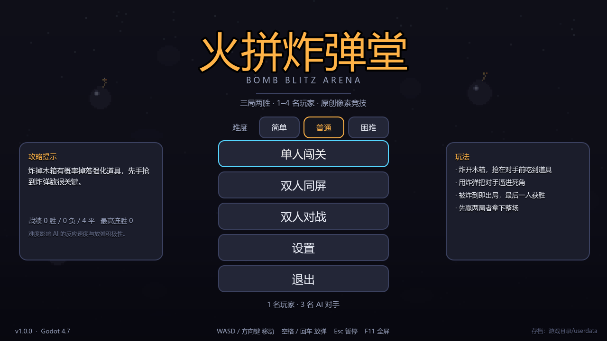
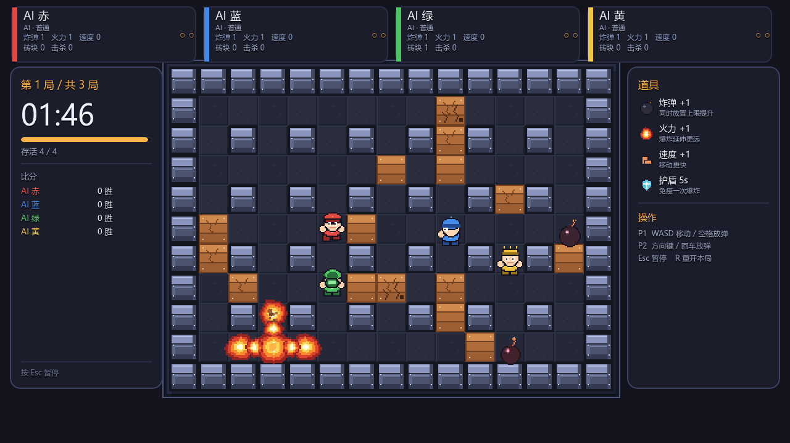

# 火拼炸弹堂 · Bomb Blitz Arena

俯视角格子炸弹竞技：放弹、走位、炸砖、抢道具，把对手炸出场外。三局两胜，支持单人闯关与双人同屏。
Godot 4.7 + GDScript，全部美术与音频由程序生成（无任何第三方素材）。





（`game/shots/` 下还有倒计时、暂停、设置、结算四张自动截图。）

## 直接开玩

| 方式 | 操作 |
|---|---|
| 成品可执行文件 | 双击 `build/火拼炸弹堂.exe` |
| 源码运行 | 双击 `启动游戏.bat`，或 `_tools/godot/Godot_v4.7.2-stable_win64.exe --path game` |
| 编辑器打开 | 用 Godot 4.7 打开 `game/project.godot`，F5 运行 |

## 玩法

- 场地 15 × 11 格，四角出生；炸开木箱抢道具，被爆炸扫到立刻出局。
- 一局 = 最后存活者胜（超时按 炸箱数 → 击杀数 判定）；一场 = 三局两胜。
- 道具：炸弹 +1（上限 6）、火力 +1（上限 6）、速度 +1（上限 4）、护盾 5 秒（免疫一次爆炸）。
- 炸弹引信 2.45 秒；爆炸沿四方向延伸，遇钢墙停止，炸碎木箱后停止，扫到其它炸弹立刻连锁。

### 操作

| | 移动 | 放弹 |
|---|---|---|
| P1 | `W A S D` | `空格` / `J` |
| P2 | `方向键` | `回车` / `小键盘 0` / `/` |

`Esc` 暂停 · `R` 重开本局 · `F11` 全屏 · `M` 静音

### 模式

| 模式 | 阵容 |
|---|---|
| 单人闯关 | 1 名玩家 + 3 名 AI（难度：简单 / 普通 / 困难） |
| 双人同屏 | P1 + P2 + 2 名 AI |
| 双人对战 | P1 vs P2 |

## 目录结构

```
game/                 Godot 工程（入口 main.tscn → src/main.gd）
  src/core/           主题、字体、存档、音频、素材加载
  src/game/           场地、角色、炸弹、火焰、AI、战斗主循环、战斗场景
  src/ui/             主菜单、HUD、设置面板
  src/dev/            自测与截图工具（不影响正常游玩）
  assets/             程序生成的像素图与合成音频
  shots/              自动截图输出（.gdignore，不参与导入）
tools/gen_art.py      像素素材生成器（Pillow）
tools/gen_audio.py    音效与 8-bit 配乐合成器（NumPy）
docs/DESIGN.md        玩法与数值设计
docs/art_preview.png  素材总览图
build/                导出的 Windows 可执行文件
dist/                 迁移用的源码压缩包（剔除引擎与导入缓存）
_tools/               本地 Godot 引擎（约 400MB，非工程内容）
```

## 开发者

### 重新生成素材

```powershell
$py = "C:\Users\huangxin\.dsh\dsh-runtimes\dsh-primary-runtime\dependencies\python\python.exe"
& $py tools/gen_art.py      # 像素图 → game/assets/*.png
& $py tools/gen_audio.py    # 音频   → game/assets/audio/*.wav
```

改动素材后需要让 Godot 重新导入：

```powershell
_tools\godot\Godot_v4.7.2-stable_win64.exe --headless --editor --path game --quit-after 150
```

### 自测（无头、不渲染）

```powershell
_tools\godot\Godot_v4.7.2-stable_win64.exe --headless --path game -- selftest
```

固定步长跑三档难度各一整场，断言：会产生炸弹/爆炸/木箱破坏、对局必然结束、局数不超上限、角色不越界。
输出 `SELFTEST PASS` 视为通过。

### 自动截图（需要显示环境）

```powershell
_tools\godot\Godot_v4.7.2-stable_win64.exe --path game -- shot=all
```

依次产出 主菜单 / 设置 / 倒计时 / 交火 / 暂停 / 结算 六张图到 `game/shots/`。

### 导出 Windows 版

```powershell
$env:TEMP = "$PWD\build\tmp"; $env:TMP = "$env:TEMP"   # 若系统临时目录不可写
_tools\godot\Godot_v4.7.2-stable_win64_console.exe --headless --path game `
  --export-release "Windows Desktop" "build/BombBlitz.exe"
```

导出模板需放在 `%APPDATA%\Godot\export_templates\4.7.2.stable\`（本机已装）。
参数在 `game/export_presets.cfg`，`binary_format/embed_pck=true`，所以 exe 可单独拷走改名。

### 代码速览

| 文件 | 职责 |
|---|---|
| `src/main.gd` | 入口：装配主题、分发界面、命令行测试钩子 |
| `src/app.gd` | 自动加载：设置、存档、音频、输入映射 |
| `src/game/battle.gd` | 回合状态机、爆炸判定、道具、AI 调度、统计 |
| `src/game/arena.gd` | 场地生成（含连通性校验）、绘制、木箱与道具 |
| `src/game/fighter.gd` | 格子对齐移动、属性、护盾、死亡表现 |
| `src/game/bot_brain.gd` | 危险图 + 安全 BFS + 抢道具 / 贴箱 / 追击 |
| `src/ui/hud.gd` | 玩家卡、计时、比分、横幅、暂停与结算 |
| `src/core/save_store.gd` | 设置与战绩持久化（含多路径回退） |

## 迁移到其它机器 / 其它 DSH 客户端

DSH 的“工作区”就是本机上的一个普通文件夹，没有云端同步；换客户端本质上是**搬目录**。

| 场景 | 做法 |
|---|---|
| 同一台机器的另一个 DSH 窗口 | 不用复制：新窗口“打开文件夹”指到本目录即可，工程原样可用 |
| 另一台机器，只想玩 | 只拷 `build/火拼炸弹堂.exe`，双击即开，不需要装引擎 |
| 另一台机器，要继续开发 | 解压 `dist/火拼炸弹堂-源码-v1.0.0.zip`（约 3 MB），再按下面“首次使用”做一次导入 |

**首次使用源码包**（新机器没有导入缓存，必须先让 Godot 导入一次，否则运行时会找不到纹理）：

```powershell
godot --headless --editor --path game --quit-after 150
```

**不要复制这三样**：`game/.godot/`（本机导入缓存与编辑器状态）、`_tools/godot/`（172 MB 引擎，各机器自行下载）、`game/userdata/`（本机存档与设置）。

想持续同步而不是每次拷包，建议把工程放进 Git（`.gitignore` 已排除上述目录）：

```powershell
git init; git add .; git commit -m "feat: 火拼炸弹堂 v1.0.0"
git remote add origin <你的仓库地址>; git push -u origin main
```

## 已知限制

- 只有本地对战，没有联机；AI 是脚本行为树，不是学习型对手。
- 中文界面依赖系统 CJK 字体（优先微软雅黑，回退 Noto Sans CJK / 黑体 / 宋体）。
- 存档优先写 `user://`；当前机器 AppData 不可写时会自动回退到 `游戏目录/userdata`，菜单右下角会显示实际位置。
- 未做手柄支持与移动端适配。

## 许可

代码、像素素材、音频均为本项目原创，可自由用于学习、修改与二次开发；不含任何第三方受版权保护的素材。
