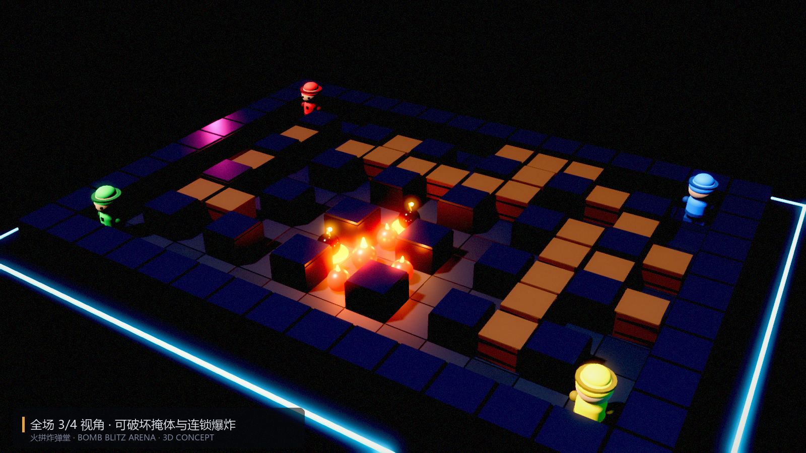
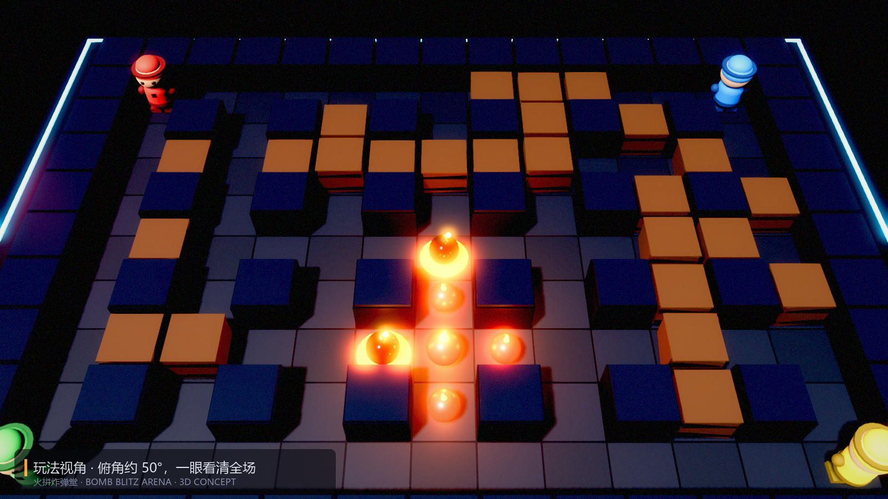
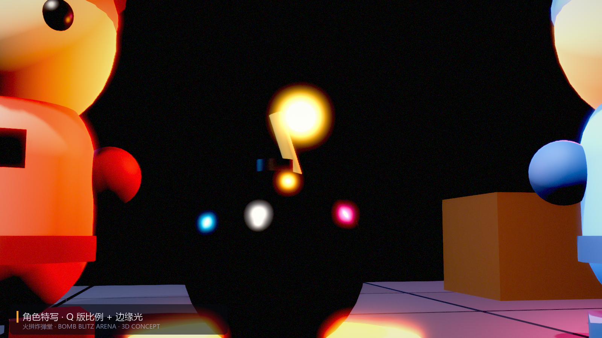
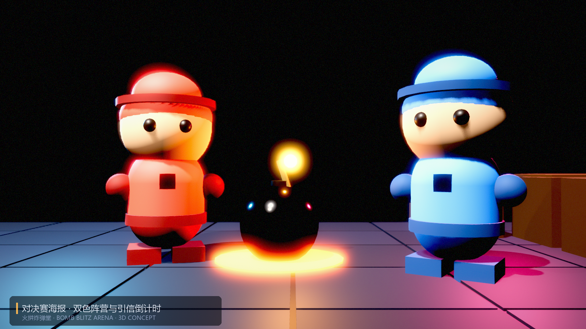
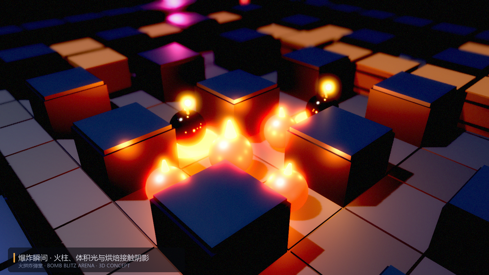

# 3D 版《火拼炸弹堂》会是什么样

一句话判断：**玩法几乎不用改，改的是镜头、可读性和表现力。**
炸弹人这套规则的乐趣来自"格子 + 视野 + 心理博弈"，3D 化只要别把格子感弄丢，收益是纯粹的观感与打击感升级。

下面 5 张图是用 Godot 4.7（Forward+，MSAA 4x / SSAO / Glow / ACES / DOF）实时渲染的探索稿，
不是手绘，也不是 AI 生图——场景、材质、灯光都在 `concept3d/` 里可复现（`tools/grade_concept.py` 做统一调色）。

## 一、镜头：3D 化的第一道生死线

2D 是正交俯视，信息 100% 可见；3D 一上透视就会遮挡。三个候选：

| 方案 | 手感 | 问题 |
|---|---|---|
| 完全俯视（90°） | 棋盘感最强、零遮挡 | 只能看到头顶，角色表现力全废 |
| **固定 3/4 俯角（55–60°）** | 能看清身体与朝向，仍有棋盘感 | 前排箱子会挡住后排 |
| 第三人称跟随 | 代入感最强 | 4 人分屏或单人切镜头都会毁掉"同屏博弈" |

**推荐 55–60° 固定俯角 + 轻微跟随**（图 1、图 2），并强制三条可读性规则：

1. **地面格子高亮**：脚下永远有 2×2 的格子投影，爆炸范围预演在地面画半透明色块；
2. **遮挡 X 光**：角色被箱子/柱子挡住时，用描边或 30% 透明显示，贴墙时给轮廓；
3. **角色永远略高于掩体**（本次概念稿把角色拉到 2.4m、箱子 1.2m），保证任何角度都能看到头顶。

## 二、玩法：只改三件事

1. **逻辑层保持格子**。移动、炸弹、爆炸判定仍然是离散格子，3D 只是渲染层。这样 AI、平衡、回放全部复用。
2. **加入"高度"要慎重**。3D 很自然会想做高低差、爆炸沿台阶蔓延——但这会打破对称地图的公平性，对 4 人混战是灾难。
   建议 v1 严格单层，v2 再拿一张专用地图试水。
3. **用 3D 强化"预判"而非"操作"**。爆炸可以有 0.15 秒的地面预热光斑、炸弹引信的火星随倒计时变亮、
   箱子裂纹随受损加深——这些在 2D 里做不出层次，在 3D 里几乎零成本。

## 三、美术方向：玩具积木感

- **比例**：Q 版 2.5 头身，角色 2.4m（刻意高于掩体），箱子 1.2m，石柱 1.4m；
- **材质**：木头哑光 + 金属包边，炸弹是哑光黑 + 强高光（图 3），地面是深色磨砂石；
- **光**：一束冷白主光 + 品红/青色轮廓光，暗背景衬托霓虹描边的场边灯条；
- **爆炸**：分层火球（深红→橙→白）+ 向上火舌 + 体积光，配合屏幕震动和手柄震动。

## 四、技术方案（如果真做）

| 模块 | 做法 |
|---|---|
| 场地 | `GridMap` + 自建 MeshLibrary；箱子用可替换 mesh，破坏时换成碎块 |
| 光照 | 一张图固定，可用烘焙（LightmapGI）省性能；炸弹/爆炸用动态 OmniLight |
| 爆炸 | `GPUParticles3D` + 火焰贴图 + 后处理热扰动，命中判定仍在逻辑格子 |
| 角色 | 骨骼动画 8 方向（或 4 方向 + 上半身朝向），比 2D 精灵工作量大 3–4 倍 |
| 相机 | 固定俯角 + 屏幕震动；不做自由旋转（会让玩家迷失方向） |
| 联机 | 只同步格子状态（放弹/移动/爆炸），不同步物理，回滚成本低 |

**成本估算**：程序与玩法约 2–3 周（现有代码可复用 60%），美术 6–10 周（角色动画是大头），
可读性调优 1–2 周。相比 2D 版本，多出来的主要是美术与镜头调试，不是玩法设计。

## 五、最大的坑

不是性能，是**可读性**：4 个 Q 版角色在箱子阵里互相遮挡，玩家会频繁"找不到自己"。
所有 3D 炸弹人类游戏最后都栽在这上面，解法只有三个——角色高亮描边、被遮挡半透、地面格子投影，
三条必须同时上，缺一条就会晕。

## 结论

值得做，但要**把它当成"2D 玩法的 3D 皮肤"**，而不是"3D 化的新游戏"。
规则、AI、平衡全部照搬，把预算砸在镜头、遮挡处理和爆炸表现上，就能得到一个"看起来贵了 5 倍、
玩起来还是那味儿"的版本。
