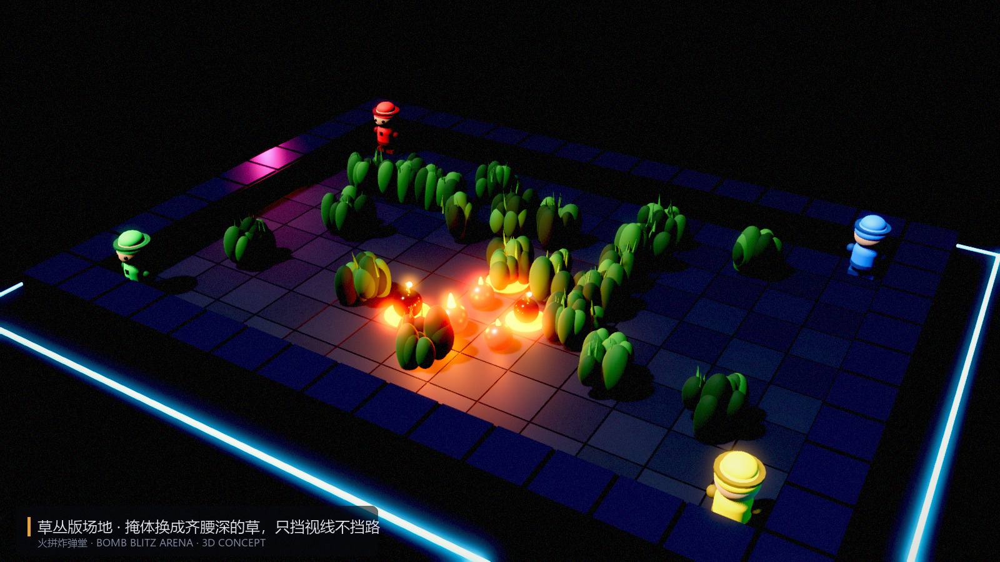
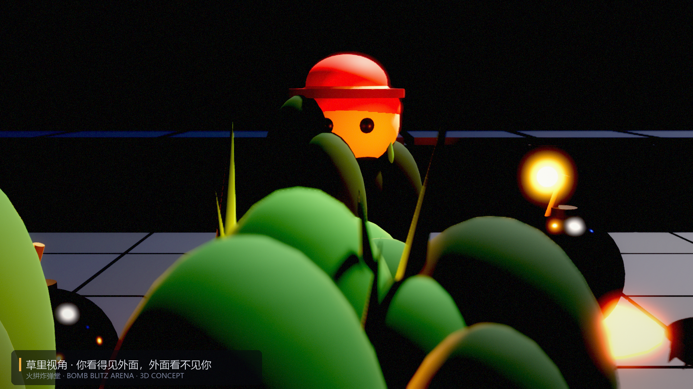

# 把石头/箱子换成草丛，NPC 会变成什么样

一句话：**这是一次「掩体 → 情报」的替换，不是换皮。**
石头和箱子决定"哪里能走、哪里能炸开"；草丛决定"谁看得见谁"。
规则要改四条，AI 要长出一整层新能力，否则 NPC 会立刻退化成一堆蹲在草里不动的木头人。



## 一、规则层要改的四件事

| 原设计 | 换成草后 | 必须补的规则 |
|---|---|---|
| 石头：不可通行、挡爆炸 | 草：可通行、**不挡爆炸** | 爆炸射程要削（否则全场一发入魂）；改成"草内爆炸距离衰减 1 格" |
| 木箱：可炸开、掉道具 | 草：**道具唯一来源消失** | 道具改成"草里藏"（走进去才看得见）或"草被烧掉必掉" |
| 掩体提供安全感 | 草只提供信息差 | 必须有反制手段：探草、烧草、声音提示 |
| 破坏=开路的战术 | 烧草=清视野的战术 | 爆炸点燃草，火沿草蔓延 1 格后熄灭 |

这样改的结果是：**场地从"迷宫"变成"开阔地 + 若干信息黑区"**，节奏其实会变快（没有墙挡爆炸），
但博弈从"走位躲火"变成"猜人在哪"。

## 二、NPC 需要的一整层新能力

现在的 AI 只有两样东西：危险图（哪里会炸）+ 安全 BFS（往哪跑）。
加草之后，它必须能处理**"我看不见的地方有人"**这件事——这需要三个新模块：

### 1. 视野判定（LOS）
沿格子做 Bresenham 直线，遇到草即阻断。这是所有决策的前置条件。

### 2. 信念地图（belief）
```
belief[cell] = { 最后见到的时间, 敌人可能的移动范围 }
```
敌人进草后不是"消失"，而是"位置不确定但可推断"：以最后位置为圆心、按速度 × 时间画一个可达圆。
AI 的投弹/绕后决策都基于这张图，而不是上帝视角。

### 3. 状态机（在现有 PATROL/CHASE 之外新增三个状态）

| 状态 | 触发 | 行为 | 退出 |
|---|---|---|---|
| **HIDE 蹲草** | 血量/火力劣势、或炸弹接近上限 | 进最近的草，停在草中心，面向敌人来向 | 敌人进入 2 格 / 蹲满 8 秒 |
| **AMBUSH 伏击** | 在草内、敌人 2 格内且背对 | 等敌人再近 1 格再放弹，封出口而不是封脚下 | 击杀或暴露 |
| **PROBE 探草** | 巡逻路线经过草、且信念图显示可疑 | **不直接穿**：先贴草边停 0.3s，或往草里丢一发弹再走 | 确认安全后通过 |

再补两条硬规则，否则 AI 会玩得很脏：

- **探草优先级随难度变化**：简单 AI 直接穿草（可以被阴），困难 AI 几乎必探。
- **蹲草有上限**：单次蹲草不超过 8 秒，否则强制出来（防止四个 AI 一起挂机）。

### 4. 反制与被反制

- 敌人放弹就暴露 0.6 秒 → AI 要在"放弹瞬间"判断是否被看见；
- 进出草有 0.2 秒窸窣提示 → AI 要利用这个窗口抓"刚进草"的人；
- 草被烧掉后视野恢复 → AI 要重新评估地图，而不是沿用旧信念。

## 三、会出现的坏结果（提前设计）

1. **四个人一起蹲草**：谁都不动，观众看静态画面。
   → 解法：草外缩圈 / 草内超时暴露 / 空投道具只在空地刷新。
2. **被草里一套秒杀的挫败感**：玩家觉得"不公平"，因为没有任何信息。
   → 解法：探草有反馈（窸窣、草叶晃动）、被击中有方向指示、爆炸会清草。
3. **AI 变呆**：最容易出现的退化是"一直蹲着不动"或"反复进出同一片草"。
   → 解法：蹲草状态加冷却（同一片草 15 秒内不再进），并给"无事可做"兜底巡逻。

## 四、落到我们这套代码上

| 文件 | 改动 |
|---|---|
| `game/src/game/arena.gd` | `Kind.CRATE` → `Kind.GRASS`；`blocks_blast()` 返回 false；新增 `blocks_vision()` 与 `is_grass()` |
| `game/src/game/battle.gd` | 加 LOS 判定、草的燃烧与蔓延、暴露计时（放弹/中弹后 0.6s 可见） |
| `game/src/game/bot_brain.gd` | `danger_map()` 之外加 `belief_map()`；状态机加 HIDE/AMBUSH/PROBE；探草用"往草里丢弹"实现 |
| `game/src/ui/hud.gd` | 显示"隐蔽中 / 已暴露"图标，让玩家知道自己的可见状态 |

工作量评估：规则层 1–2 天，AI 3–5 天（主要在信念地图和状态机的调参），美术 2 天。
比 3D 化的成本低得多，但对玩法的影响比换视角大得多。

## 五、结论

值得做，但要清楚它换掉的是**游戏的核心信息结构**：

- 原来：你在明处，靠走位躲爆炸；
- 现在：你在暗处，靠信息差决定"什么时候出手"。

如果保留一部分木箱（草管视野、箱子管道具），两种乐趣可以并存——
这也是我更推荐的版本：**草 + 箱子混搭，而不是全换**。


