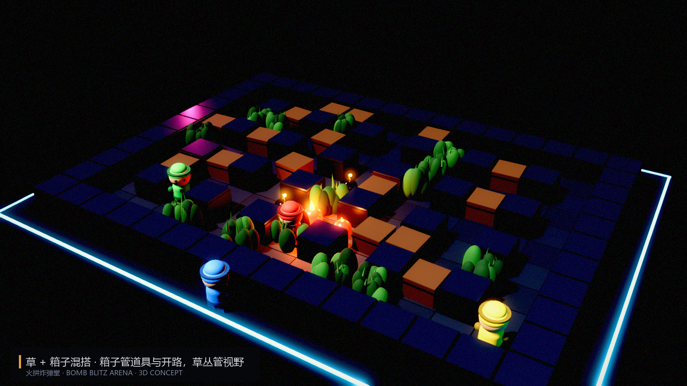
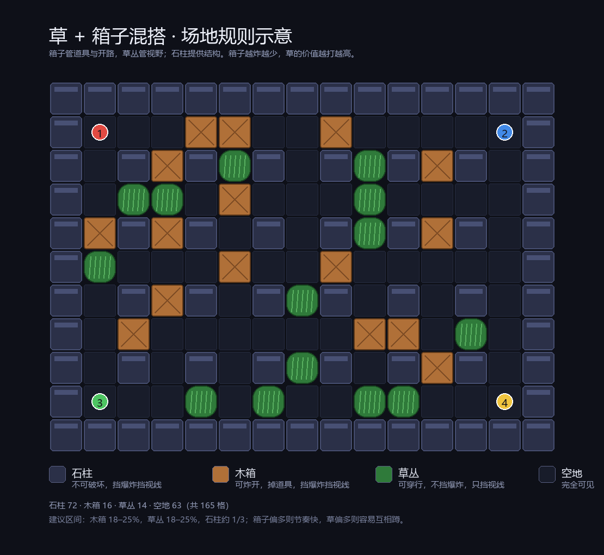
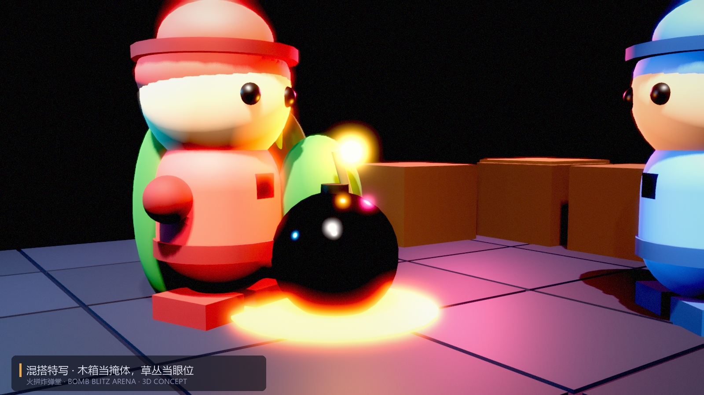

# 草 + 箱子混搭：3D 版的推荐方案

一句话：混搭的意义不是“两种掩体都留着”，而是让**一局里掩体的性质随时间变化**——
箱子会被炸掉，草不会。地图自己会演进，不需要缩圈来逼节奏。



## 一、场地配比



| 元素 | 数量（15×11=165 格） | 占比 | 生成规则 |
|---|---|---|---|
| 石柱 | 72 | 44% | 围栏 + 偶数坐标柱阵，不可破坏 |
| 木箱 | 16 | 10% | hash 分布，出生点 2 格内清空 |
| 草丛 | 14 | 8% | 同上，与木箱互斥 |
| 空地 | 63 | 38% | — |

按“可布置区域”（165 − 72 石柱 − 18 出生保护区 = 73 格）算，木箱 22%、草丛 19%。
建议区间：**木箱 18–25%，草丛 18–25%**，两者接近但箱子略多。

## 二、三种掩体的语义

| | 挡移动 | 挡爆炸 | 挡视线 | 掉道具 |
|---|---|---|---|---|
| 石柱 | ✓ | ✓ | ✓ | ✗ |
| 木箱 | ✓ | ✓ | ✓ | ✓（炸开时） |
| 草丛 | ✗ | ✗ | ✓ | ✗ |

一句话记：**石柱是墙，木箱是墙 + 宝箱，草是眼罩。**

## 三、核心洞察：掩体价值曲线

这是混搭方案最值钱的地方——它有天然的阶段感：

| 阶段 | 木箱存量 | 场地形态 | 最优策略 |
|---|---|---|---|
| 开局（0–30s） | 16 | 通道多、视野碎 | 抢道具、炸开路；草没有价值（到处都能躲） |
| 中期（30–70s） | 8 左右 | 视野逐渐打开 | 开始占草，用草卡对手的推进路线 |
| 后期（70s+） | 0–3 | 开阔地 + 零星草丛 | 草是唯一掩体，伏击与反伏击主导 |

不需要缩圈、不需要倒计时施压，**地图自己会把玩家从“躲箱子”推到“抢草丛”**。

## 四、三条必须补的交互规则

1. **草里放弹会暴露 0.6 秒**。否则蹲在草里无成本放弹，等于无敌。
2. **草被爆炸扫到会“倒伏”3 秒**（可被看见），不是直接烧掉。比摧毁温和，但足以反制蹲坑。
3. **木箱炸掉后原地留空**，不生成草。让“破坏”是不可逆的——这才有阶段推进。

## 五、AI：一套状态机，两条价值曲线

上一轮设计的 HIDE / AMBUSH / PROBE 全部保留，但决策函数要加时间维度：

```
cover_value(cell, t) =
    木箱权重 × (1 - t/90)      # 箱子越到后期越少，能炸就炸
  + 草丛权重 × (t/90)          # 草越到后期越值钱，值得提前占
```

- **前期不许蹲草**：蹲草 = 放弃道具 = 慢性自杀，AI 要能算这笔账；
- **中期开始抢草**：尤其是能卡住对手必经之路的那几片；
- **后期必须守草**：箱子没了，草就是唯一的“先手权”。

调参要点：给 AI 一个 `camp_cooldown`（同一片草 15 秒内不重复蹲），否则会出现两个 AI 隔草对望。

## 六、数值风险

| 症状 | 原因 | 调整 |
|---|---|---|
| 回合拖长、像原版 | 木箱太多，通道战没结束 | 木箱降到 18%，或提高火力上限 |
| 全员蹲草、场面静止 | 草丛太密 | 草降到 16%，或缩短单次蹲草上限 |
| 70% 击杀来自草里 | 草太强 | 加“暴露 0.6s”或草倒伏 |
| 开局 20 秒就清场 | 箱子太少、爆炸太强 | 提高箱子比例或降低初始火力 |

建议上线后埋两个指标：**平均回合时长**、**击杀来源分布（草/箱/开阔地）**，用它们反过来调比例。

## 七、3D 表现要点

- 草用顶点动画做风摆；被爆炸扫到时压弯 3 秒；
- 木箱碎裂用物理碎块，碎块落地后 2 秒淡出；
- 角色被箱子/草遮挡时做 X 光描边（混搭模式下遮挡更频繁，这条是刚需）；
- 地面始终有格子投影，草里也一样（否则玩家会在草里迷路）。



## 八、结论

混搭是这三个方案里**唯一同时保留“破坏的爽”和“信息差的博弈”**的做法，而且额外赚到一个
“地图随时间演进”的节奏设计——这是纯箱子或纯草都给不了的。

实现成本比纯草低：草丛只需要 LOS 与暴露计时，木箱逻辑一行不用改。
