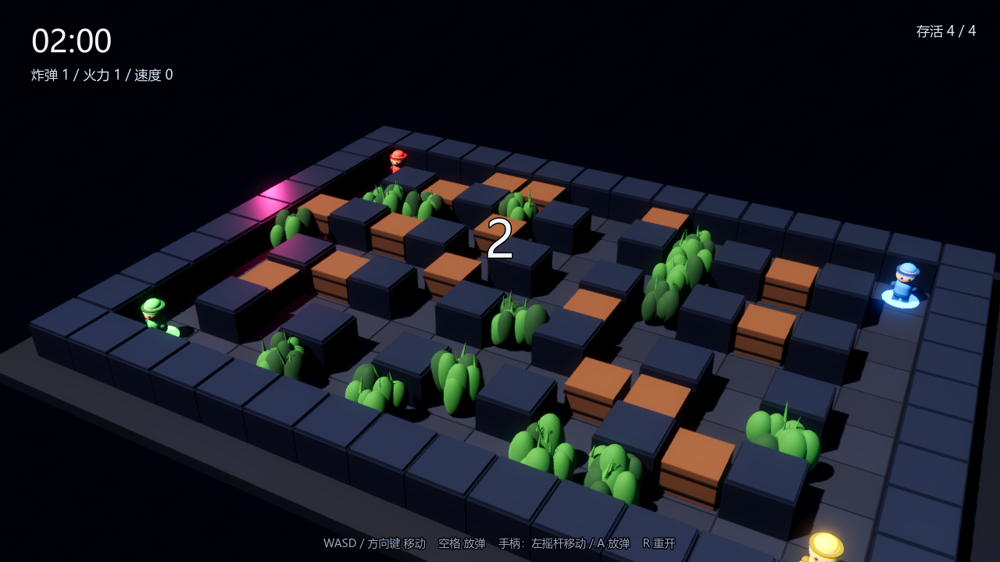
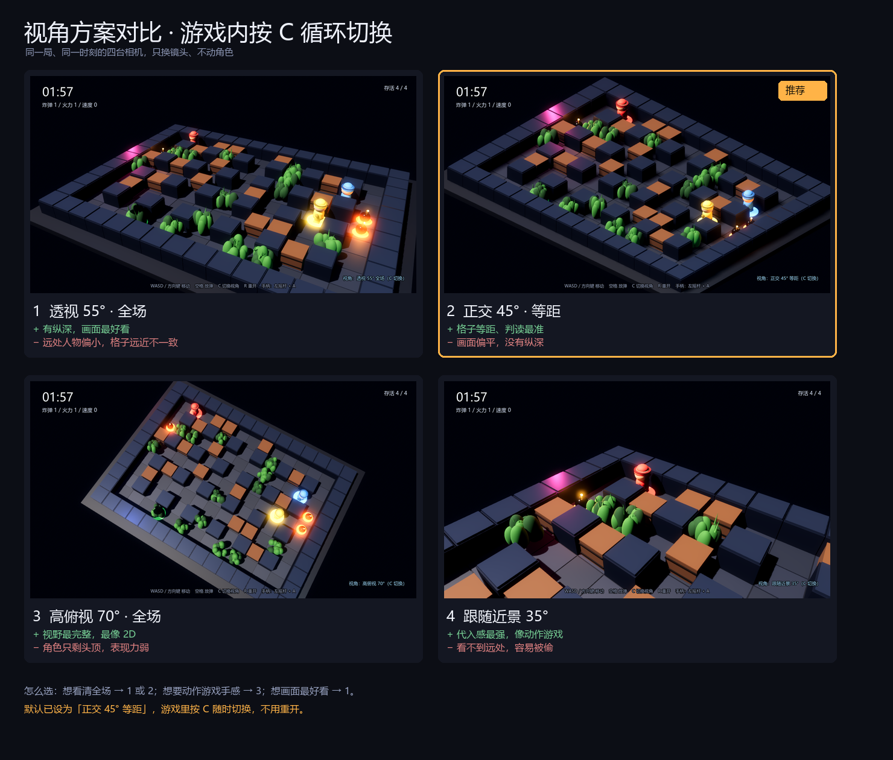
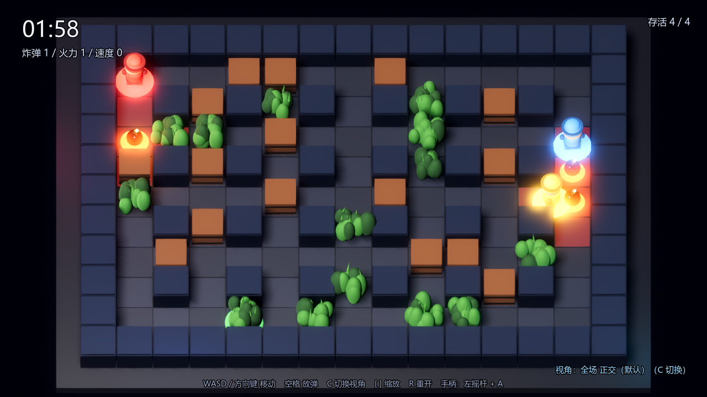

# 火拼炸弹堂 3D（可玩版）

3D 化的炸弹竞技：**草 + 箱子混搭**的场地，1 名玩家 vs 3 个 AI。
和 2D 版是两个独立工程，2D 版完全不受影响。



## 怎么玩

| 方式 | 操作 |
|---|---|
| 成品 | 双击 `../build/火拼炸弹堂3D.exe` |
| 源码 | `_tools\godot\Godot_v4.7.2-stable_win64.exe --path game3d` |
| 编辑器 | 用 Godot 4.7 打开 `game3d/project.godot` |

**操作**：`WASD` / 方向键移动，`空格` / `J` 放弹，`R` 重开，手柄左摇杆 + `A`。

**规则**：炸掉对手，最后一个活着的赢；超时 120 秒按炸箱数判定。
木箱炸开有 38% 概率掉道具（炸弹 +1 / 火力 +1 / 速度 +1）。

## 视角：4 种，按 C 循环



| # | 视角 | 适合 |
|---|---|---|
| 1 | 透视 55° 全场 | 想画面好看、有纵深 |
| 2 | **正交 45° 等距（默认）** | 想看清格子、判读最准 |
| 3 | 高俯视 70° 全场 | 想复刻 2D 俯视 |
| 4 | 跟随近景 35° | 想要动作游戏手感 |

默认选的是正交等距：没有透视变形，远近格子一样大，4 人混战时最容易判断“我在哪、火会烧到哪”。

## 混搭场地

| 元素 | 挡移动 | 挡爆炸 | 挡视线 | 掉道具 |
|---|---|---|---|---|
| 石柱 | ✓ | ✓ | ✓ | ✗ |
| 木箱 | ✓ | ✓ | ✓ | ✓ |
| 草丛 | ✗ | ✗ | ✓ | ✗ |

- **进草丛自动隐蔽**：对手看不到你（你的模型半透明，对手的模型完全隐藏），放弹会暴露 1.4 秒。
- **爆炸会把草压塌 3 秒**：倒伏期间不挡视线，是探草的主要手段。
- 箱子会越炸越少，草不会——所以一局会自然从“通道战”过渡到“草丛伏击战”。



## AI 会做什么

- 危险图 + 安全 BFS（放弹前先算退路）；
- **视线感知**：草和箱子挡住视线时看不到你，只记得你最后出现的位置；
- **探草**：看到你钻进草里，会走到草边丢一发弹；
- **蹲草**：30% 概率在没目标时猫进草里，蹲 3–6 秒后强制出来（有冷却，防止挂机）；
- **追击**：看不见人时也会朝最近的对手压过去，不会原地发呆。

## 和 2D 版的差异

| | 2D 版 | 3D 版 |
|---|---|---|
| 镜头 | 固定正交俯视 | 固定 55° 俯角，带轻微跟随偏移 |
| 场地 | 石墙 + 木箱 | 石柱 + 木箱 + 草丛 |
| 隐蔽 | 无 | 草里隐身、放弹暴露、爆炸压草 |
| 角色表现 | 像素精灵 | 程序化 Q 版模型 + 脚下光圈 |
| 局数 | 三局两胜 | 单局（重开按 R） |

## 工程结构

```
game3d/
  main.tscn                入口
  src/main.gd              场景、回合、输入、爆炸、隐蔽、镜头
  src/tile_world.gd        网格数据、混搭地形生成、视线与爆炸范围
  src/hero3d.gd            角色模型与格子移动
  src/bomb3d.gd            炸弹表现
  src/blast3d.gd           爆炸表现
  src/bot3d.gd             AI（危险图 / 感知 / 蹲草 / 探草）
  src/hud3d.gd             HUD
  src/look.gd              材质、网格、环境、灯光
  assets/audio/            复用 2D 版合成的音效
  shots/                   自动截图
```

## 自测

```powershell
_tools\godot\Godot_v4.7.2-stable_win64.exe --headless --path game3d -- selftest    # 逻辑：跑一整局并断言
_tools\godot\Godot_v4.7.2-stable_win64.exe --headless --path game3d -- inputtest   # 输入通路：模拟按键
_tools\godot\Godot_v4.7.2-stable_win64.exe --path game3d -- shot                   # 四个阶段截图
```

`selftest` 断言：必然产生炸弹、爆炸、木箱破坏、击杀，且对局在 300 秒内结束。
`inputtest` 注入真实的 `InputEventKey`，验证按 D 能移动、按空格能放弹。

## 已知限制

- 单人 vs AI，没有联机，也没有本地双人（3D 分屏是另一个量级的工作）。
- 单局制，没有三局两胜与结算面板（2D 版有）。
- 手感和平衡是首版：AI 只有一档难度，镜头不做自由旋转（避免眩晕）。
- 隐蔽机制为了可读性做了妥协：**你自己进草是半透明的**（能看见自己），对手则是完全隐藏。
